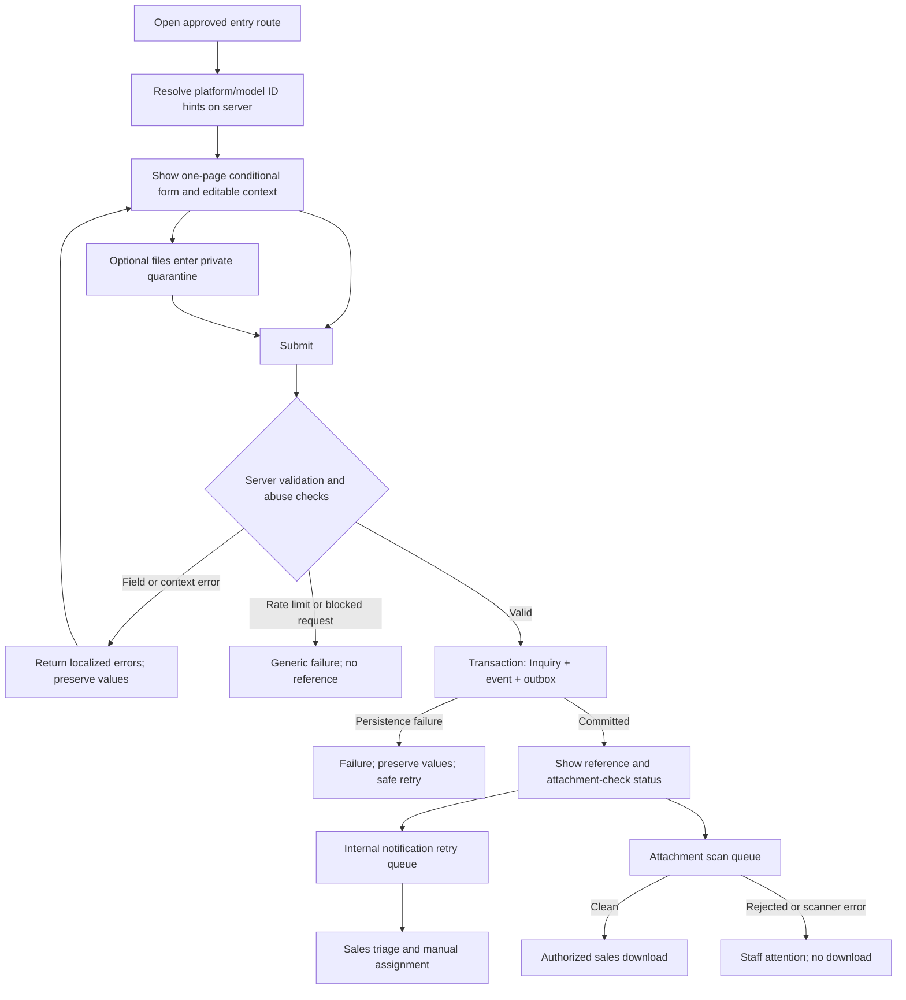

# Inquiry Workflow

Status: **design workflow, not an operating service**. Field rules live in [Inquiry-Field-Definition.md](Inquiry-Field-Definition.md), persistence and permissions in [Inquiry-Data-Model.md](Inquiry-Data-Model.md), and release tests in [RFQ-Acceptance-Criteria.md](RFQ-Acceptance-Criteria.md).

## 1. Actors and outcomes

| Actor | Allowed action | Not allowed |
| --- | --- | --- |
| Visitor | Open `/request-quote` or `/contact`, change visible product/type, enter data, upload eligible optional files, submit, receive an opaque reference. | Read an inquiry by reference, assert a product price/model/fitment fact, or see private attachment storage. |
| Next.js submission service | Validate request, resolve Payload product/model IDs, apply abuse controls, persist Inquiry/Event/Outbox, return localized result. | Trust browser validation or client-supplied price, image, model label, or privacy version. |
| Upload/scan worker | Validate and scan private files; mark Clean or Rejected; release Clean files to authorized staff. | Expose temporary or rejected files through a public URL. |
| Notification worker | Send internal alert from outbox, retry and report failure; later send customer receipt only after its separate release gate. | Roll back a saved inquiry because mail failed. |
| Sales staff / admin | Triage, assign manually, contact buyer, close, inspect Clean files, view event history according to role. | Change immutable product snapshot or privacy evidence without an audited correction. |

## 2. End-to-end flow

### Step A — Entry and product context

1. `/request-quote` renders Product Inquiry, Custom Project, or OEM/ODM selection; `/contact` renders General Inquiry through the same engine. Product-page CTAs use the existing quote route with optional stable `platformId` and `modelId` query hints. No RAYONE hash-query pattern or extra public route is required.
2. The server looks up each hint in the approved Payload platform/model source. It confirms publication and model-to-platform relationship before displaying a label. A valid model implies its platform. Invalid or withdrawn context is visibly marked for re-selection; it is never copied into a trusted hidden field.
3. The buyer can change the type, platform, and model. Changing platform clears a mismatched model. Shared contact and description draft values remain during type changes; hidden inapplicable fields are not submitted or saved. Vehicle/application is optional free text for Wheels/Safety Tires, not a fitment lookup.

### Step B — Optional upload before submit

1. A short-lived, server-issued upload session binds temporary files to one form attempt. Count, size, allowlist, filename safety, content signature/structure, and request ownership are checked on the server. The accepted initial policy is 5 files, 25 MB each, 50 MB total; PDF, PNG, JPG, STEP, DWG, DXF only. The selected storage and scanner must prove support for each type before public release.
2. Store each file under a random key in private quarantine, never its browser filename or a public media URL. A structurally invalid or oversized file is rejected immediately with a file-specific error; the buyer may remove it and submit the inquiry without it. The rest of the form remains intact.
3. Valid temporary attachment IDs are linked to a saved inquiry only after ownership and expiry checks. Unbound temporary files expire and are deleted under an approved cleanup policy. An asynchronous scan then marks each attachment PendingScan → Clean or Rejected. Scanner failure remains unavailable for download and produces staff attention; it is not silently treated as Clean.

### Step C — Submit boundary

1. Accept only POST through the controlled submission boundary. Apply origin/CSRF checks, request-size limits, a hidden honeypot, rate limits, and an accessible risk-based challenge if activated. The security controls are provider-neutral; thresholds and provider remain operational configuration, not invented in this specification. [Next.js Server Actions configuration](https://nextjs.org/docs/app/api-reference/config/next-config-js/serverActions), [OWASP CSRF](https://cheatsheetseries.owasp.org/cheatsheets/Cross-Site_Request_Forgery_Prevention_Cheat_Sheet.html), and [OWASP bot guidance](https://cheatsheetseries.owasp.org/cheatsheets/Bot_Management_and_Anti-Automation_Cheat_Sheet.html) inform the boundary.
2. Parse only known fields, normalize safely, and run the same required, length, enum, conditional, privacy-notice, and upload checks specified in [Inquiry-Field-Definition.md](Inquiry-Field-Definition.md). Never accept client-supplied product price, image, or name as authoritative. Re-resolve IDs immediately before commit; stale or mismatched context returns a field error with preserved user entries.
3. For a valid request, atomically create the Inquiry, initial New event, reference, and internal-notification outbox item. Link eligible quarantined files. If the write fails, return an error without a success reference and preserve inputs for an idempotent retry. A retry with the same form attempt must return the same saved reference if the first commit succeeded.
4. The result page is localized. It says the inquiry was received **only after durable save**, displays the opaque reference, and separately states when files are still being checked. A reference is not a public lookup secret or proof that attachments passed scanning. Do not claim a response time or quote price.

### Step D — Notifications and attachment checks

1. A worker sends the internal notification asynchronously to a verified, configured recipient. The message includes reference, type, and authenticated admin link; it does not attach drawings. Retries use the outbox's idempotency key. Delivery failure is logged and alerted for staff; the visitor's successful saved state remains valid.
2. Customer receipt email is off at launch until an outbound domain, service, localized template, and privacy review are approved. When later enabled, delivery failure is operationally visible but does not retroactively fail the web submission. The on-page reference remains the primary first-release confirmation.
3. Attachment scan results update `attachmentState`. Only Clean files can be downloaded by authorized staff. Rejected files are isolated; staff can see a safe reason code and follow an approved exception procedure, then contact the buyer if a replacement is needed. Do not expose scanner details, storage URLs, or unsafe file contents in customer-facing messages.

## 3. User-visible failure and retry states

| Condition | Visitor result | System result |
| --- | --- | --- |
| Missing/invalid required or conditional field | Inline error plus form-level summary, focus to summary/first error, valid values retained. | No Inquiry created. |
| Invalid/unpublished model or platform mismatch | Visible product selection error and re-selection; other fields retained. | No trusted snapshot from client; no Inquiry until resolved. |
| File type/size/count error before submit | Error beside file control; buyer can remove file and continue. | Invalid file not attached; quarantine cleanup applies. |
| Honeypot, CSRF/origin, rate limit, or abuse rejection | Generic localized error; no false success/reference; appropriate retry guidance without exposing thresholds. | No public record access; security event according to approved retention. |
| Database/persistence failure | Form-level error, values retained, safe retry. | No success reference unless the idempotency lookup finds a committed record. |
| Network timeout after possible commit | Retry action with same attempt; do not ask buyer to submit a fresh duplicate. | Idempotency returns existing reference if committed, otherwise creates once. |
| Scan pending after saved body | Success reference plus explicit file-check status. | Inquiry remains New; files unavailable until Clean. |
| Scan rejected after saved body | Previously shown inquiry success remains true; later communication is handled by staff/approved customer channel. | Attachment marked Rejected/Attention; no download. |
| Internal email failure | No change to saved confirmation. | Outbox retries and operational alert; no data loss. |

## 4. Sales lifecycle and permissions

| Transition | Actor | Required evidence/action |
| --- | --- | --- |
| Create → `New` | Submission service | Durable save plus reference and initial event. |
| `New` → `Triaged` | Authorized sales/admin | Review type, buyer need, trusted platform/model context, attachment status. Do not assume a file is clean. |
| `Triaged` → `Assigned` | Authorized sales/admin | Manual assignment to an active authorized staff user; event records actor and time. |
| `Assigned` → `Contacted` | Assigned sales/admin | Record that outreach occurred, with minimal internal note. No automated claim of customer receipt. |
| `Contacted` → `Closed` | Assigned sales/admin | Record close reason/note under access control; no invented win/loss taxonomy is required. |

Abuse review and attachment scan states run **parallel** to these sales states. A suspected spam item can be withheld from ordinary sales views until review without falsifying a saved legitimate inquiry. Exceptional status corrections require an append-only event and administrator permission. No automatic assignment, response SLA, quote generation, or conversion claim is specified.

## 5. Privacy, localization, and operations

- Real submission remains disabled until a reviewed privacy notice, processing wording, retention period, deletion/correction process, and authorized recipient/access configuration are in place. Marketing opt-in is separate and unchecked. Store the accepted notice version/locale and server timestamp; do not put raw PII into logs or notification URLs. Applicable legal obligations must be checked for the target markets; [GDPR Articles 5 and 13](https://eur-lex.europa.eu/eli/reg/2016/679/oj/?pid=14006577) are a source for minimization/transparency principles, not a determination of jurisdiction.
- The current public route and form are English only. Future locales need published equivalent pages, localized errors/consent/status/email templates, and updated Sitemap/ADR before enablement. Preserve the buyer's original language in the record; sales can see the form locale. Do not silently translate a requirement or change its meaning.
- Operational configuration must include private storage, scanning, upload cleanup, rate-limit thresholds, sender/recipient addresses, outbox retries/alerts, staff roles, backups, and retention/deletion. These values are **TBD** release gates. The [Runbook](../../docs/context/RUNBOOK.md) does not yet document verified run, test, or deployment procedures; none is claimed here.
